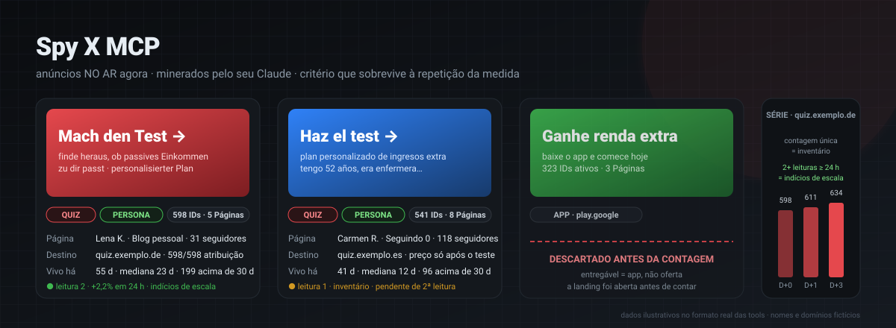
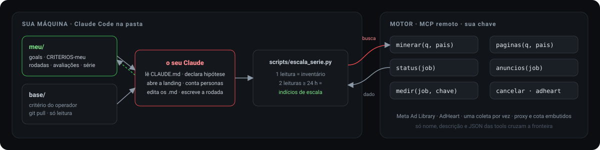
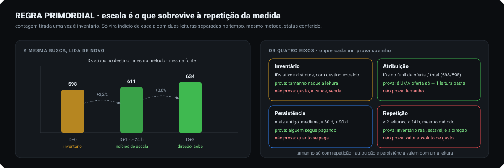
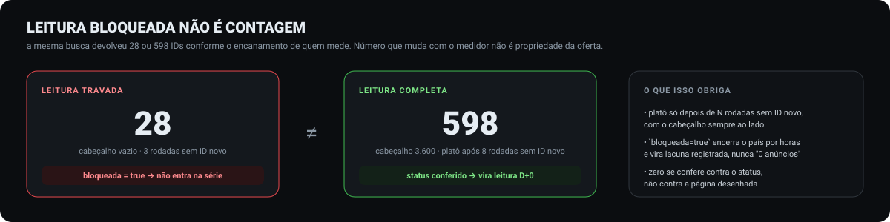
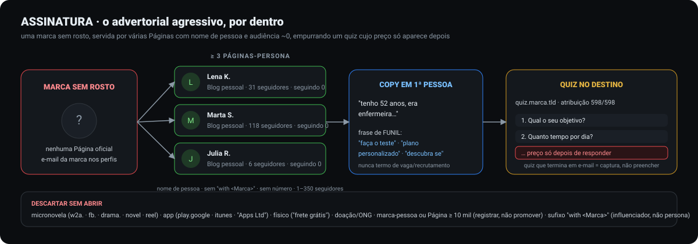
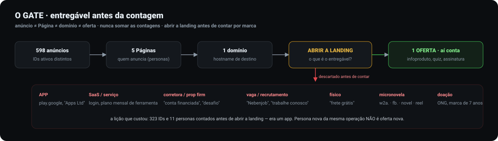
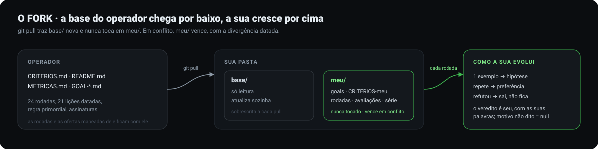

# Spy X MCP

<p align="center"></p>

<p align="center">


</p>

Inteligência de anúncios e catálogos, com confirmação de veiculação atual nas bibliotecas públicas,
operada pelo seu Claude. Você clona esta pasta, cola a sua chave
e opera em conversa: o motor coleta, o seu Claude audita com um critério já calibrado em 24 rodadas, você
dá o veredito, e o que você aprende fica gravado em `.md` que só você edita. A base do operador chega por
`git pull`; a sua nunca é sobrescrita.

## Conta Spy X — atualização de 31/10/2026

O endpoint agora anuncia **34 ferramentas**: as 14 do fluxo legado e 20 para
conta, créditos, acervo, ranking, preferências e fila de coleta. Para as novas,
configure sua chave pessoal `ar_` e comece por `conta_identidade`.
Veja [como usar sua conta](docs/conta.md), incluindo os custos, a chave de
idempotência e as diferenças entre a conta e os acessos legados.

A fila da conta tem executores implementados para AdHeart, Foreplay e Tyver,
sujeitos a orçamento, ativação operacional e capacidade válida. No Tyver, uma
página reserva até 60 views mesmo quando o limite de saída é menor; falta de
orçamento ou janela autorizada impede a execução. As demais fontes ainda
dependem de adaptadores e capacidade validada. A publicação do contrato não é
garantia de disponibilidade de todas as fontes. O servidor recusa chaves inválidas
e não empresta a identidade do operador. As cinco novas ferramentas de escrita
não foram incluídas na lista de aprovação automática do cliente.

## Histórico do fluxo legado — 24/09/2026

O fluxo legado expõe **14 ferramentas** e considera **dez mineradores credenciados**,
além das bibliotecas públicas Meta e Google. `planejar_fontes` decide quais
fontes servem para a rede e o país escolhidos; `fontes` mostra pré-requisitos e
último teste; `minerador` consulta as fontes elegíveis; e
`minerador_resultados` filtra um catálogo já coletado sem repetir a consulta.
O VAV também permite descobrir por catálogo, leaderboard, canal e domínio.

Os quatro Goals em `base/` têm critérios úteis, mas suas versões curtas e seus
comandos locais são históricos. Para uma nova rodada, monte um Goal em
`meu/goals/` pelo [modelo atual](meu/goals/GOAL-EXEMPLO.md), defina rede e país,
aprove o texto final e siga [o ciclo do MCP](docs/ciclo.md). Depois de `git pull`,
abra uma nova tarefa no Codex ou uma nova sessão no Claude Code para carregar as
instruções atualizadas.

**Qualidade da rodada:** o roteiro não garante encontrar as melhores ofertas de
todo o mercado. A entrega deve mostrar a cobertura das buscas e a decisão para
cada fonte, confirmar anúncio pago no país, destino e produto, e separar
inventário de indícios de escala. Estes exigem duas leituras comparáveis com
intervalo de pelo menos 24 horas. Candidatos sem essa prova ficam no ranking
parcial, com links, datas e lacunas. Ainda não há um auditor automático que
aprove ou reprove cada rodada por esses critérios.

## Em 30 segundos

| | |
|---|---|
| **O que é** | um motor que descobre ofertas e mede indícios de escala, separando *inventário* de *escala* e *anúncio* de *oferta* |
| **O que você precisa** | um cliente MCP, git, Python 3 e sua chave individual: `ar_` para a conta ou a chave legada para o fluxo anterior |
| **O que você não precisa** | conta em fonte nenhuma, proxy, infraestrutura: tudo isso mora no motor, atrás da chave |
| **O que fica com você** | goals, critério, rodadas, avaliações e séries em `meu/`, na sua máquina |

## Comece

```bash
git clone https://github.com/sip-group-llc/spyx-mcp
cd spyx-mcp
```

Escolha o cliente:

**Claude Code:** troque `<SUA_CHAVE>` no [`.mcp.json`](.mcp.json) pela sua chave individual e rode na pasta:

```bash
claude
```

Na primeira abertura, aceite a confiança na pasta para carregar o `.mcp.json` e as ferramentas do motor.

**Codex:** adicione ao `~/.codex/config.toml` do seu usuário (no Windows,
`%USERPROFILE%\.codex\config.toml`) e substitua `<SUA_CHAVE>`:

```toml
[mcp_servers.spyx]
url = "https://arasaka.corex11.tech/mcp"
http_headers = { Authorization = "Bearer <SUA_CHAVE>" }
```

Abra esta pasta em uma nova tarefa do Codex; o [AGENTS.md](AGENTS.md) orienta o fluxo. Confira se o MCP
`spyx` aparece com `planejar_fontes`, `fontes`, `minerador`, `minerador_resultados`, `google`, `minerar` e `status`. O
`config.toml` é pessoal; não coloque a chave em arquivos versionados nem publique seu `.mcp.json` editado.
Se atualizar o pacote, `python scripts/check_mcp_contract.py` confere se as
ferramentas documentadas, as permissões e o roteamento continuam coerentes.

Primeira conversa: **"como eu uso isso?"** ou
**"prepare uma rodada de renda extra no YouTube, região ES"**. O agente confere o escopo, mostra o Goal
exato e pergunta se você aprova ativá-lo. Envie `/goal` somente depois dessa revisão se quiser a trava
antes da ativação; o aplicativo pode ativar um `/goal` colado diretamente antes de o agente ler a mensagem.

Sem chave? Abra uma issue [pedindo acesso](../../issues/new?template=acesso.md).

## Como funciona

<p align="center"></p>

Uma rodada é uma conversa em seis passos: **preparar** (ler o critério e as suas rodadas;
`planejar_fontes` escolhe as fontes pela rede) → **minerar**
(Meta: biblioteca + mineradores compatíveis → `minerar(fonte="meta")` → `anuncios`; YouTube:
`google` → `google_resultados` → VAV quando a sessão responder →
`youtube_video`) → **revisar** (abrir a landing e medir a audiência) →
**ouvir** (o seu veredito, com as suas palavras) → **refinar** (editar o seu critério e o seu goal) →
**medir** (`medir` → série local). Fecha em `meu/rodadas/Rnnn.md`. As capacidades e limitações de cada
fonte estão em [docs/fontes.md](docs/fontes.md); o ciclo completo está em [docs/ciclo.md](docs/ciclo.md).

## A teoria por trás

Tudo o que está abaixo é a base pública em `base/`, desenhada. O seu Claude aplica isso sozinho; você só
precisa saber que existe.

### Escala é o que sobrevive à repetição da medida

<p align="center"></p>

A regra que vence todas as outras. Contagem única é inventário; "escalada" só com duas leituras separadas
por 24 h, mesmo método. Atribuição e persistência valem com uma leitura; tamanho, nunca. A tool `medir` e o
script de série aplicam isso por você: com uma leitura, o texto diz "inventário".

### Leitura bloqueada não é contagem

<p align="center"></p>

Um número que muda com quem mede não é propriedade da oferta. Por isso o motor devolve `bloqueada=true` em
vez de zero, e o zero nunca entra na série.

### A assinatura do advertorial agressivo

<p align="center"></p>

O padrão que o critério sabe reconhecer: marca sem rosto, várias Páginas com nome de pessoa e audiência
quase zero, copy em primeira pessoa com frase de funil, quiz cujo preço só aparece depois. `status` já
devolve a triagem por esses sinais; `paginas` mede os seguidores.

### O gate: entregável antes da contagem

<p align="center"></p>

Anúncio, Página, domínio e oferta são coisas diferentes e nunca se somam. Abrir a landing vem antes de
qualquer contagem por marca: app, SaaS, serviço, corretora, vaga, físico e micronovela saem antes de virar
número.

### O fork: a base do operador por baixo, a sua por cima

<p align="center"></p>

`base/` é do operador e atualiza sozinha. `meu/` é seu, nunca é tocado, e vence em conflito. Um exemplo
vira hipótese; repetição vira preferência; o que foi refutado sai.

## Uma rodada inteira, sem cutucar

Uma rodada leva horas: várias buscas, esperas, medição. Peça a rodada ("minera renda extra no BR,
traz os mais escalados") em mensagem comum. O agente pergunta apenas o que faltar, mostra o texto final
e espera sua aprovação antes de ativar `/goal`. A rodada entrega finalistas comprovados **e** os achados
mais fortes que ficaram abaixo dos critérios, com links e motivos; registra descobertas em `meu/`.
O procedimento está em [docs/goal-preflight.md](docs/goal-preflight.md).

## Quanto tempo leva uma busca

Uma busca pode levar minutos. A Meta pode bloquear a sessão e devolver `bloqueada=true`; isso não é zero
anúncios. `status(job, esperar=60)` acompanha a execução e `cancelar(job)` interrompe. Mineradores pagos
dependem da sessão, da assinatura e da quota atuais. `fontes()` confirma pré-requisitos, e a resposta do job
confirma a execução. Consulte uma fonte compatível por vez dentro dos limites informados.

## O que tem na pasta

```
CLAUDE.md          o ciclo, a base por dentro, a tradução base → motor, as regras
AGENTS.md          entrada do Codex e trava de aprovação antes do Goal
base/              CRITERIOS · README (ciclo) · METRICAS · GOAL-ADVERTORIAL · GOAL-RENDA-EXTRA · GOAL-RENDA-EXTRA-YOUTUBE · GOAL-RELACIONAMENTO
meu/               CRITERIOS-meu · goals/ · rodadas/ · avaliacoes.jsonl · serie-escala.jsonl · dados/
scripts/           escala_serie.py — a série da regra primordial
docs/              tools do motor (gerado) · pré-voo do Goal · ciclo · exemplo · diagramas
.claude/           permissões pré-aprovadas: tools do motor, WebFetch, o script; base/ bloqueada para escrita
```

## Atualizar a base do operador

```bash
git pull
```

O pacote atualiza `base/`, instruções e docs. Seus registros em `meu/` continuam pessoais. Leia o diff
antes da próxima rodada; se um arquivo pessoal seu tiver o mesmo nome de um novo arquivo do pacote, resolva
o conflito preservando seus dados.

Mais: [as tools do motor](docs/tools.md) · [as fontes](docs/fontes.md) · [o ciclo](docs/ciclo.md) · [uma rodada de exemplo](docs/rodada-exemplo.md) · [changelog](CHANGELOG.md)
